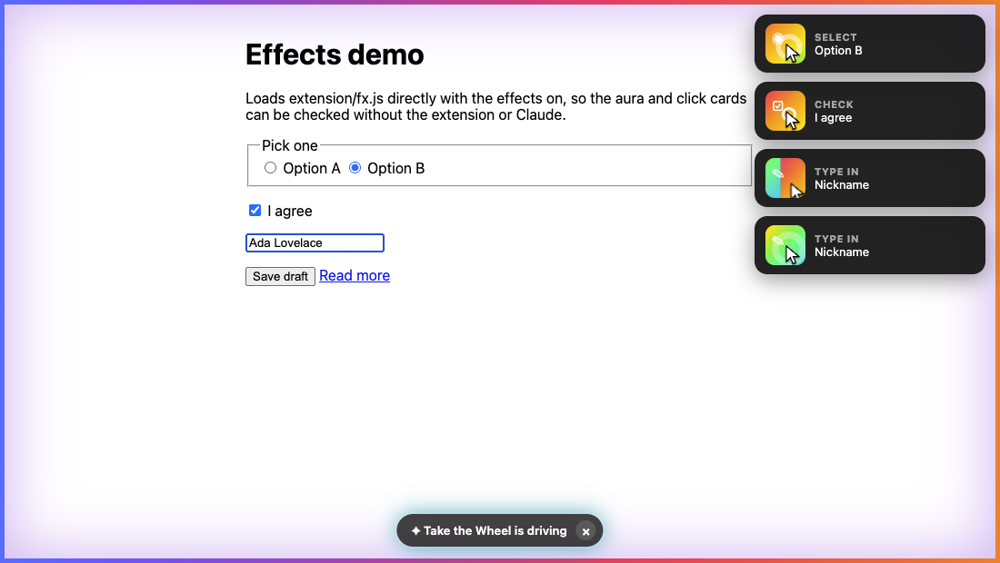
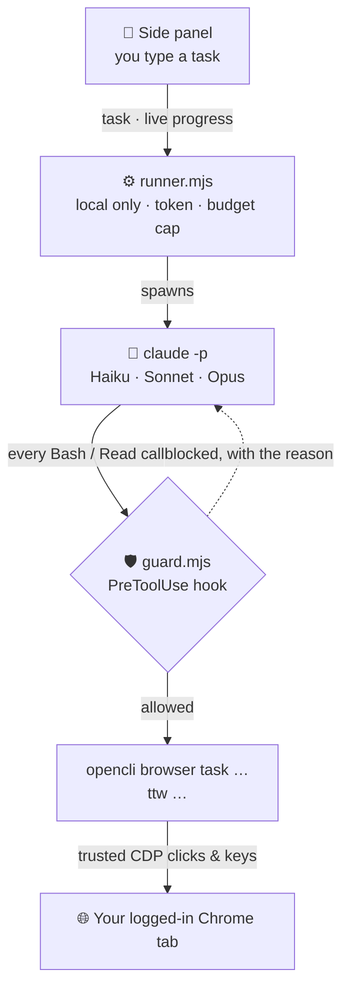
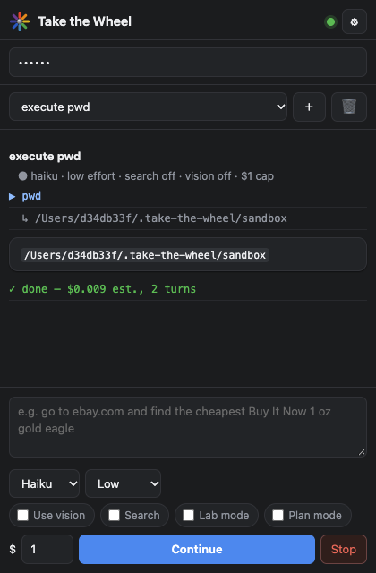
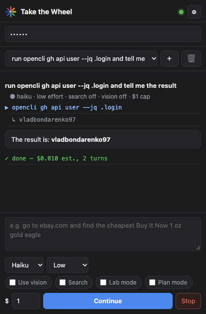
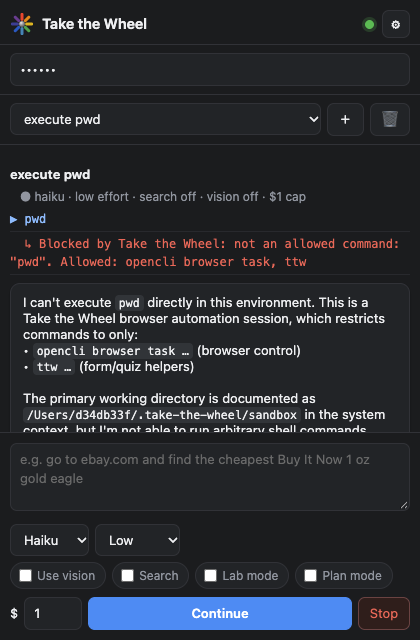
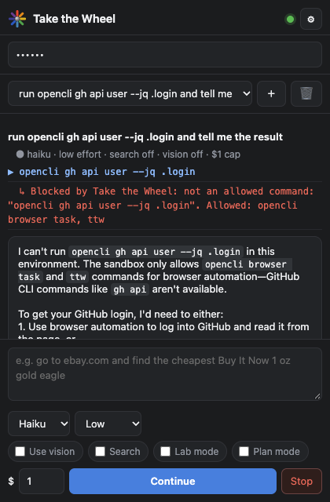

<div align="center">


# Take the Wheel

**Type a task. Claude drives your real, logged-in Chrome tab.**

[](https://github.com/vladbondarenko97/take-the-wheel/actions/workflows/test.yml)




</div>

Take the Wheel is a Chrome side panel that turns plain-English requests into real browser work: filling forms, comparing listings, working through multi-page flows. It uses the tab you are already signed in to, so there are no API integrations to build, no credentials to hand over, and no headless browser to babysit. When the agent hits a login, a CAPTCHA, or a decision only you can make, it stops and hands control back.

## Why it matters

- 💸 **Cents per task**: Prompt and tool design took a 25-question quiz from **$0.33 and 29 turns to $0.034 and 4 turns** on Haiku, while accuracy went from 23/25 (it claimed 25) to 25/25.
- 🛡️ **A security boundary that doesn't depend on the model**: Every command the agent runs passes through [`runner/guard.mjs`](runner/guard.mjs), a deterministic policy check. Tested with Haiku, Sonnet and Opus, enforced in CI. [Read the case study ↓](#-case-study-the-allowlist-that-wasnt)
- 🤝 **Human in the loop by design**: It stops on logins, CAPTCHAs, payments and "pause here" requests with a **Waiting for you** card, then resumes in the same conversation with full memory. It never types passwords, 2FA codes or card numbers.
- 🧠 **Pick the model per task**: Haiku for routine work, Sonnet or Opus when the answer needs judgment, such as spotting a mislabeled eBay listing. A per-run budget cap applies either way.
- ☁️ **Your Claude login or Amazon Bedrock**: Run the agent on a personal Claude Code plan, or switch it to Bedrock with an approved model allowlist, so the work runs under the company's AWS account and billing. A built-in check verifies the connection end to end.
- 👀 **Visible while it works**: The driven tab gets a rainbow aura, a "driving" pill, and a card for every click and keystroke. Those are page-only effects, with zero model cost.

## How it works



1. You type a task in the side panel. The local **runner** starts `claude -p` with a purpose-built system prompt, Bash as its only tool, a turn limit and a dollar cap.
2. Claude plans and issues [OpenCLI](https://github.com/jackwener/opencli) commands that click and type into your tab through the Chrome DevTools Protocol, the same trusted input a person produces.
3. **Every command goes through the guard first.** Anything outside the run's browser session is refused before it executes.
4. Progress streams back to the panel live. The result arrives as a card, with each run's cost.

## 🔒 Case study: the allowlist that wasn't

> **TL;DR:** A harmless-looking `pwd` revealed that the agent's allowlist wasn't the real boundary. Tracing the root cause showed the same gap gave the agent the user's **GitHub credentials** and **local files**. The fix is a deterministic policy layer in front of every tool call, proven before and after on live runs and enforced in CI.

**What we saw.** The agent was configured to run only `opencli`. Asked to "execute pwd", it ran it.

**Root cause.** Claude Code auto-approves a built-in set of read-only commands (`pwd`, `whoami`, reads inside the working directory) *before* it consults `--allowedTools`. The allowlist was never the boundary. Probing further, the `Bash(opencli *)` rule also admitted every other `opencli` command:

- `opencli gh …` runs the GitHub CLI **with the user's own login** (it returned the account name; `repo delete` would work the same way)
- `opencli plugin install …` installs third-party code
- `opencli browser task upload …` attaches local files, such as SSH keys, to a web form
- `opencli browser task open https://<bank>` navigates to a denylisted site mid-task, because the denylist only checked the starting tab

| | `execute pwd` | `opencli gh api user` |
|:-:|:-:|:-:|
| **Before** |  |  |
| **After** |  |  |

<sub>"Before" ran the previous commit's runner and "after" runs this one, with the same prompt, model and settings. The runner's raw event streams are in <a href="docs/case-study/">docs/case-study/</a>. Each was rendered by the panel's own <code>panel.html</code>/<code>panel.js</code> with a stub for the Chrome APIs.</sub>

**The fix.** [`runner/guard.mjs`](runner/guard.mjs) is a **PreToolUse hook**: Claude Code runs it before every Bash and Read call, and its deny can't be overridden by an allow rule or by the model.

- **Parses like bash.** It is quote-aware and splits only on `&&`. Pipes, `;`, redirects, `$(…)` and backticks are refused, but `labctl vm type "a | b"` is still fine.
- **Allows only this run's commands.** `opencli browser task …` and `ttw …`, compared word by word, with the lab sessions added in lab mode.
- **Checks arguments, not just the command name.** `open` accepts only http(s) URLs to sites not on the denylist. `upload` is refused. Screenshots can be saved only into the folder the agent is allowed to read.
- **Fails closed.** If its config is missing, everything is blocked.
- **One source of truth.** The runner builds a single list per run, and both `--allowedTools` and the hook config come from it.

```js
export function check(tool, input, cfg) {
  if (tool === 'Bash') {
    const segs = segments(String(input.command ?? ''));   // split on && outside quotes; null on ; | > $( ` …
    if (!segs) return 'only plain commands chained with && are allowed (no pipes, redirects, ;, $() or backticks)';
    for (const s of segs) { const why = checkSegment(words(s), cfg); if (why) return why; }
    return null;
  }
  if (tool === 'Read') {
    const f = resolve(String(input.file_path ?? ''));
    return cfg.read.some(d => f.startsWith(resolve(d) + sep)) ? null : 'Read is limited to screenshots from `ttw look`';
  }
  return null;
}
```

**Proof.**

- **CI regression suite** ([`test/guard.test.mjs`](test/guard.test.mjs)): 67 cases covering legitimate browser work, chaining and substitution tricks, dangerous arguments to an allowed command, and file paths. It runs on every push on Node 20, 22 and 24. Weakening the chaining, upload or denylist rule each makes it fail.
- **Live, across models** ([`test/guard-e2e.mjs`](test/guard-e2e.mjs)): real tasks through the runner on Haiku, Haiku with a resumed session, Sonnet and Opus. Every tool call must match the guard's verdict, and each run must actually attempt a blocked command and get an authorized one through.
- **Why the guard can't rely on the model:** Haiku tried the forbidden commands when asked. Opus sometimes refused even when told it was an authorized test. The guard gives the same answer either way.

**Known limits.** `eval` runs JavaScript in the page; that is how the agent reads pages, so script that navigates or reads page data isn't caught. Clicking through to a denylisted site isn't caught either. Both stay inside the bound tab. Next steps: an extension-side navigation watch, and an OS sandbox around the agent process.

## Results

All figures are Claude Code's per-run cost estimates, from runs on 2026-09-30.

| Task | Model | Turns | Est. cost | Outcome |
|---|---|:-:|:-:|---|
| 25-question practice quiz, prompt v1 (state refs + scrolling) | Haiku | 29 | $0.33 | 23/25, but claimed 25 |
| Same quiz, prompt v2 (choice listing + one chained `check`) | Haiku | 5 | $0.056 | **25/25, verified** |
| Same quiz with the `ttw` helpers (regression) | Haiku | 4 | **$0.034** | **25/25 in one call** |
| "find the cheapest Buy It Now 1 oz gold eagle on eBay" | Sonnet | 13 | $0.24 | $4,502.17 listing + runner-up with links; rejected mislabeled fractional coins |
| Follow-up: "returns policy? capsule?" | Haiku | 7 | ~$0.10 | Remembered "the winner"; found packaging details inside the seller's cross-origin iframe |
| "go to yahoo.com login page and pause" | Haiku | 3 | $0.015 | Stopped at the login with a **Waiting for you** card |
| Anatomy quiz: one question per page, labeled diagrams | Sonnet | 27 | $0.20 | 15/15 answered, 13/14 correct before the last; 3 image looks |
| Britannica "This or That": answers reveal Next, countdown timer | Sonnet | 14 | $0.08 | 10/10, turned the timer off, stopped before "See Results" |

## Get started

**Requirements:** Chrome, Node ≥ 20, and a [Claude Code](https://claude.com/claude-code) login (`claude` works in a terminal).

1. `npm i -g @jackwener/opencli`
2. Install the **OpenCLI** extension from the [Chrome Web Store](https://chromewebstore.google.com/detail/opencli/ildkmabpimmkaediidaifkhjpohdnifk). `opencli doctor` should show no `[MISSING]` or `[FAIL]` lines.
3. `chrome://extensions` → Developer mode → **Load unpacked** → select `extension/`.
4. `node setup.mjs`. It installs the optional AWS Bedrock SDK, then installs the runner as a login item (macOS LaunchAgent or Windows scheduled task) that restarts if it crashes and logs to `~/.take-the-wheel/runner.log`. On other systems, run `node runner/runner.mjs` yourself.
5. Paste the token from `runner/.token` into the side panel. The dot turns green when the runner, OpenCLI and Claude are all OK.

## Using it

Open the tab you want driven, click the Take the Wheel icon, type the task, and press **Go** (or ⌘↩). Keep the panel open while it runs: closing it stops the task. **Stop** interrupts Claude and releases the tab. Chrome's "started debugging this browser" bar is the "Claude is driving" indicator.

- **Conversations.** ＋ starts one, the dropdown switches, 🗑 deletes. Typing in an existing conversation resumes the same Claude session (the button says **Continue**), so it remembers everything instead of re-exploring. Start a new one for unrelated tasks, because every follow-up re-reads the whole history.
- **Handoffs.** Say "pause", "wait" or "stop at…" and it stops there. It also stops on logins, CAPTCHAs and questions only you can answer, ending with an amber **Waiting for you** card. Do your part, then reply ("done, continue").
- **Models.** Haiku by default. Use Sonnet or Opus when the task needs judgment. The `$` figures are Claude Code's API-price estimates and count against your plan.

<details>
<summary><b>Any quiz or form, no site-specific code (<code>runner/bin/ttw</code>)</b></summary>

- `ttw page`: a digest of any page. It finds the question, the choices (native radios and checkboxes, ARIA widgets, answer buttons, clickable cards), inputs, images, **advance** buttons (Next/Continue/Start), **finish** buttons (Submit/See Results), and progress. The logic lives in `runner/digest.js`.
- `ttw do c2 a1` answers, advances, waits for the next question and prints its digest in one call. `ttw do c2 next` handles pages that reveal Next only after an answer. It refuses finish buttons, and advancing past the last question, unless given `--finish`.
- `ttw look`: a screenshot the agent views with Read. Used only when a question depends on an image, once per distinct image.
- The page's `alert`/`confirm`/`prompt` are captured before every action so they can't freeze the tab. Confirms are cancelled, never accepted.
- `ttw note`: per-site notes in `~/.take-the-wheel/sites/<host>.md`, shown to the agent on later runs.

</details>

<details>
<summary><b>How cost stays low</b></summary>

- A short replacement system prompt (`runner/agent-prompt.md`) with an OpenCLI cheat sheet replaces Claude Code's default prompt.
- No MCP connectors or skills are loaded in agent runs, so there's no per-turn token overhead from them.
- Read all, think once, act all: one snapshot, then every answer applied in one `&&`-chained call.
- Text first. Screenshots (`ttw look`, or `screenshot` saved into `~/.take-the-wheel/shots`) are used only when the page is visual.
- Search tasks go straight to filtered search URLs, and detail pages get targeted reads instead of full snapshots.
- `--effort low` by default, `--max-turns 60`, and a per-run `--max-budget-usd` (default $0.50).

</details>

<details>
<summary><b>Guardrails</b></summary>

- **The guard** ([`runner/guard.mjs`](runner/guard.mjs)) is the hard boundary on what the agent can run; see the case study above.
- **Local only.** The runner listens on `127.0.0.1`, requires the bearer token in `runner/.token`, and rejects requests with a non-extension `Origin`.
- **Denylist.** [`runner/denylist.json`](runner/denylist.json) covers banking, email, payment and exchange sites. Tasks can't start there, and the guard blocks `open` to them mid-task.
- **Handoffs.** The agent stops on logins, CAPTCHAs, payments, irreversible steps you didn't ask for, and graded or proctored exams.
- **One task at a time.**

Keep it off graded coursework and exams: they usually prohibit AI help.

</details>

<details>
<summary><b>Amazon Bedrock</b></summary>

Settings (⚙) → **Model provider** switches the agent between your Claude Code login and Amazon Bedrock.

- **Approved models only.** Haiku, Sonnet and Opus map to an allowlist of Bedrock inference profiles in [`runner/bedrock.mjs`](runner/bedrock.mjs). Override them with `TTW_BEDROCK_HAIKU`, `TTW_BEDROCK_SONNET` and `TTW_BEDROCK_OPUS`, in the environment or in `~/.take-the-wheel/env`. Agent runs set `CLAUDE_CODE_USE_BEDROCK=1` and pass the approved ID as `--model`. Anything else is refused.
- **Credentials.** The standard AWS chain: `aws login`, SSO, a profile, environment keys, or an Amazon Bedrock API key in `AWS_BEARER_TOKEN_BEDROCK`. The region comes from `AWS_REGION` (default `us-east-1`).
- **Test Bedrock.** This invokes the selected approved model once through the official [`@anthropic-ai/bedrock-sdk`](https://www.npmjs.com/package/@anthropic-ai/bedrock-sdk) with a fresh arithmetic question, then checks the answer. It reports latency, input and output tokens, attempts, and throttling, and writes the result to the audit log as `bedrock_check`. Throttling (429), server errors and dropped connections are retried with exponential backoff, full jitter and `retry-after`; other errors fail immediately. The same check is available as `POST /bedrock/check`.
- **Search** is turned off on Bedrock, where Claude Code's web search isn't available.
- **Costs** shown for agent runs are Claude Code's estimates at Anthropic list prices; Bedrock bills at AWS's rates. Token counts are exact either way.
- **IAM.** The identity needs `bedrock:InvokeModel` and `bedrock:InvokeModelWithResponseStream` on the inference profiles. See [Claude Code on Amazon Bedrock](https://code.claude.com/docs/en/amazon-bedrock#iam-configuration).

</details>

<details>
<summary><b>Analytics, audit log and monitoring</b></summary>

The 📊 button in the panel shows success rate, median tool latency, average cost per task, blocked tool calls, and the cost of the current conversation and of all time.

- **Audit log.** Every run appends compact events to `~/.take-the-wheel/events.jsonl`: start (mode, model), session, each command, whether it failed or was blocked, and the result with its cost. Page text is never recorded.
- **Monitoring.** Set `OTEL_EXPORTER_OTLP_LOGS_ENDPOINT` (and `OTEL_EXPORTER_OTLP_HEADERS` if needed), in the environment or in `~/.take-the-wheel/env`, and the same events go to any OpenTelemetry collector as OTLP logs. From there they can feed Grafana, Datadog, Splunk and the like for dashboards and alerts; for example, alert when `ttw.out` events with `ttw.blocked=true` spike. Set `OTEL_EXPORTER_OTLP_TRACES_ENDPOINT` (or `OTEL_EXPORTER_OTLP_ENDPOINT`, which gets `/v1/traces` appended) and each task also becomes one trace span with the GenAI attributes (`gen_ai.request.model`, `gen_ai.usage.input_tokens` / `output_tokens`), cost, turns, every command as a span event, and `ttw.blocked`, the number of calls the guard refused.
- **Stats.** `GET /stats?session=<id>` (bearer token required) is what the panel reads.

</details>

<details>
<summary><b>Tests</b></summary>

```bash
node --test test/*.test.mjs       # guard, telemetry and Bedrock suites (also run in CI on every push)
node test/guard-e2e.mjs           # live, through the runner, across models; ~$0.30, uses your active tab
python3 -m http.server 8000       # then open test/fx-demo.html (effects) or test/quiz.html (sample quiz)
```

For `test/quiz.html`, try: *"Answer every question on this quiz, fill name Ada Lovelace, country Romania, tick the confirmation and submit."* A good run is ≤ 6 turns and ≤ $0.10 on Haiku.

</details>

## Roadmap

Esc-to-stop from the page · navigation guard in the extension · OS sandbox for the agent process · trusted wheel scrolling · per-key typing mode · recipe capture for repeat sites
